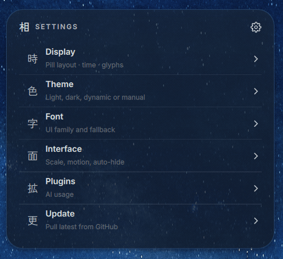

# Ukishima AI Usage

An AI usage pill for [Ukishima](https://github.com/amanhex/ukishima). See your
quota at a glance, hover for a quick breakdown, or click for details and reset
times. It follows your shell's theme and adds a Plugins page to Settings.


Animations when the agent is running and waiting for user input:


## Requirements

- Ukishima already running on Hyprland, with a writable source checkout.
- Python 3.9 or newer.
- [ai-usagebar](https://github.com/akitaonrails/ai-usagebar) installed,
  configured, and available in Ukishima's PATH.

Check that `ai-usagebar usage --json` returns your usage before installing.

## Install

Clone or download this repository and enter its directory. First check that
your Ukishima version is compatible:

```sh
python3 install.py install --ukishima "$HOME/.local/share/quickshell/ukishima" --check
```

Then install. The script stops and restarts Ukishima if it is running:

```sh
python3 install.py install --ukishima "$HOME/.local/share/quickshell/ukishima"
```

The script keeps the original files in
`.ukishima-ai-usage/`. Keep that backup directory. For Nix-managed installations,
apply the installer to a writable source copy during the build.

Before updating Ukishima, remove the extension with the command below, then
reinstall afterward. Removal refuses to overwrite files you've edited.

```sh
python3 install.py uninstall --ukishima "$HOME/.local/share/quickshell/ukishima"
```

## Settings



Open **Settings → Plugins → AI usage pill** to control when the pill appears.

| Option | Behavior |
| --- | --- |
| On | Always show the pill. |
| Off | Always hide the pill. |
| Auto | Show it when quota usage is above zero or an integrated agent is running or waiting. |

## Codex and Claude integration

The status helper accepts `running`, `waiting`, or `idle`. Replace
`/path/to/ukishima-ai-usage` below with this repository's location, and merge
the examples into any hooks you already have.

For [Codex](https://learn.chatgpt.com/docs/hooks), add this to
`~/.codex/hooks.json`:

```json
{
  "hooks": {
    "UserPromptSubmit": [{
      "hooks": [{
        "type": "command",
        "command": "sh /path/to/ukishima-ai-usage/bin/ukishima-ai-status running"
      }]
    }],
    "PreToolUse": [{
      "matcher": "^request_user_input$",
      "hooks": [{
        "type": "command",
        "command": "sh /path/to/ukishima-ai-usage/bin/ukishima-ai-status waiting"
      }]
    }],
    "PostToolUse": [{
      "matcher": "^request_user_input$",
      "hooks": [{
        "type": "command",
        "command": "sh /path/to/ukishima-ai-usage/bin/ukishima-ai-status running"
      }]
    }],
    "Stop": [{
      "hooks": [{
        "type": "command",
        "command": "sh /path/to/ukishima-ai-usage/bin/ukishima-ai-status idle"
      }]
    }]
  }
}
```

Open `/hooks` in Codex to review and trust the new commands.

For [Claude Code](https://code.claude.com/docs/en/hooks), add this to
`~/.claude/settings.json`:

```json
{
  "hooks": {
    "UserPromptSubmit": [{
      "hooks": [{
        "type": "command",
        "command": "sh /path/to/ukishima-ai-usage/bin/ukishima-ai-status running"
      }]
    }],
    "Notification": [{
      "matcher": "idle_prompt|agent_needs_input",
      "hooks": [{
        "type": "command",
        "command": "sh /path/to/ukishima-ai-usage/bin/ukishima-ai-status waiting"
      }]
    }],
    "Stop": [{
      "hooks": [{
        "type": "command",
        "command": "sh /path/to/ukishima-ai-usage/bin/ukishima-ai-status idle"
      }]
    }]
  }
}
```

The widget automatically selects one provider with percentage quotas.
Provider switching and balance-only accounts aren't supported yet.
